# Deep JSON Color Schemes

Color themes that give every level of JSON nesting its own color, so you can see at a
glance which level a piece of content belongs to. Six palettes are included, each in
two bracket styles (vivd and muted):

- **Monokai Classic** — the Monokai palette, with depth colors layered on top
- **Monokai Chalk** — a more pastel palette (my favorite)
- **Monokai Neon** — Monokai's accent colors at full strength
- **Monokai Neue** — inspired by Monokai Neue, with its six-color cycle
- **Jazz Solo Cup** — the teal and purple of the 1990s Jazz cup design
- **VS Code Dark** — Dark 2026, the theme VS Code ships, with depth colors on top

Each theme appears in the picker under the `Deep JSON:` prefix, so the twelve themes group
together rather than scattering among your other themes.

Depth counts objects and arrays alike, so a key nested inside two arrays and an object gets
the same color as one nested four objects deep. It is aimed at the kind of document that
nests past what you can hold in your head: OpenAPI specifications, package lockfiles, cloud
configs, API captures, etc.

Use Sublime Text? You can get [Deep JSON for Sublime Text][sublime].

[sublime]: https://github.com/lanz/sublime-deep-json

## Contents

- [What it looks like](#what-it-looks-like)
- [Requirements](#requirements)
- [Installation](#installation)
- [Palette gallery](#palette-gallery)
  - [Monokai Classic](#monokai-classic)
  - [Monokai Chalk](#monokai-chalk)
  - [Monokai Neon](#monokai-neon)
  - [Monokai Neue](#monokai-neue)
  - [Jazz Solo Cup](#jazz-solo-cup)
  - [VS Code Dark](#vs-code-dark)
- [Use a palette for JSON only](#use-a-palette-for-json-only)
- [Bracket coloring](#bracket-coloring)
- [Indentation guides](#indentation-guides)
- [Markdown highlighting](#markdown-highlighting)
- [Customize the colors](#customize-the-colors)
- [Why I built this](#why-i-built-this)
- [How depth coloring works](#how-depth-coloring-works)
- [Development and extending the themes](#development-and-extending-the-themes)
- [Credits](#credits)
- [License](#license)

## What it looks like

A vulnerability-findings OpenAPI spec in **Deep JSON: Monokai Chalk**. The response schema
reaches fourteen levels, so the palette has cycled by the bottom of the file.

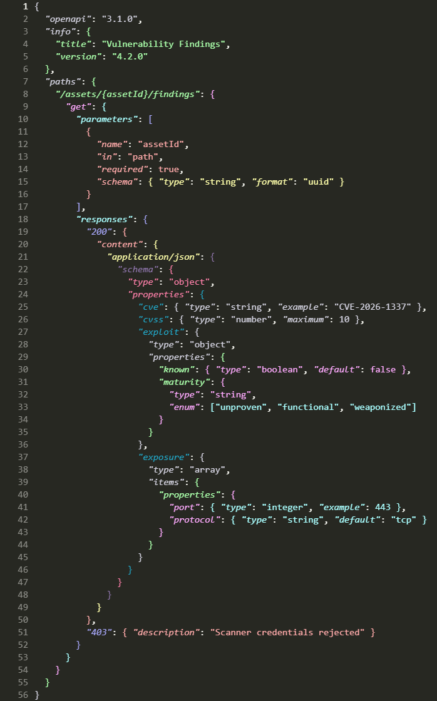

The `samples/` folder holds the JSON used for every shot on this page, if you want to
compare them yourself.

## Requirements

**Visual Studio Code 1.75 or newer**, or the equivalent VSCodium build, which is what the
extension declares in `engines`.

Depth coloring arrives as semantic tokens, which each theme turns on for itself. If you have
overridden that globally you will need `"editor.semanticHighlighting.enabled"` set to `true`
or `"configuredByTheme"`.

## Installation

Pick a theme from **File → Preferences → Theme → Color Theme**, or run *Preferences: Color
Theme* from the Command Palette, then filter on `deep json`.

## Palette gallery

Each palette below is shown against the same three sample files, so you can compare
them directly.

### Monokai Classic

Built on **Monokai**, the palette by Wimer Hazenberg. The base palette stays intact and the
depth colors are layered on top, so everything outside JSON still looks like the Monokai you
already know.

This is the original version of the idea: take the palette everyone recognizes and use it to
give JSON's nesting some visual structure.

| Objects | Arrays | Mixed |
|---|---|---|
| 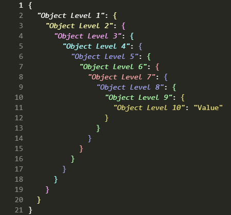 | 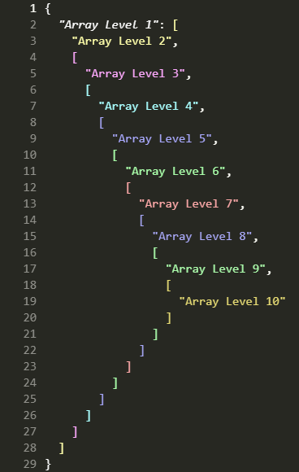 | 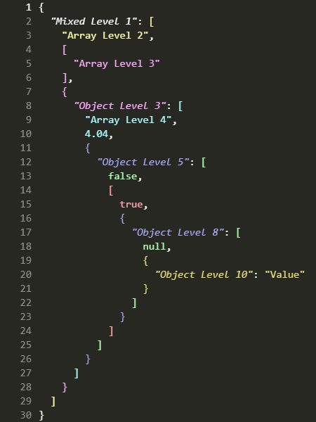 |

### Monokai Chalk

This is the one I use. It's also my favorite.

Monokai Classic came first, and it carried a minor flaw: four of its ten levels are
near-duplicates of each other. You don't really notice it in a small file. You notice it
five or six levels down, which is exactly where you need the colors to be doing the most
work.

Chalk uses a soft, pastel feel near the surface, but fixes the repetition. Every level
gets a color that is distinct enough to recognize, and the deep end gets a purple, a pink,
and a teal of its own. Open a spec that nests ten levels deep and the shape starts to
resolve at a glance.

The name comes from the palette's pastel, almost chalky colors.

| Objects | Arrays | Mixed |
|---|---|---|
| 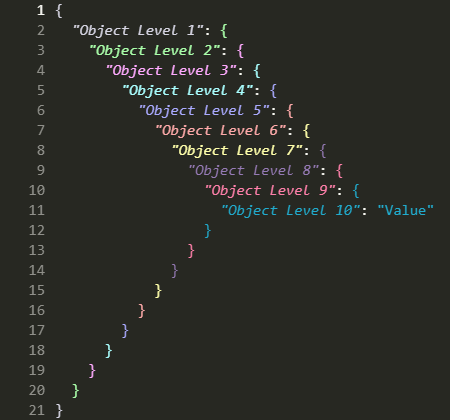 | 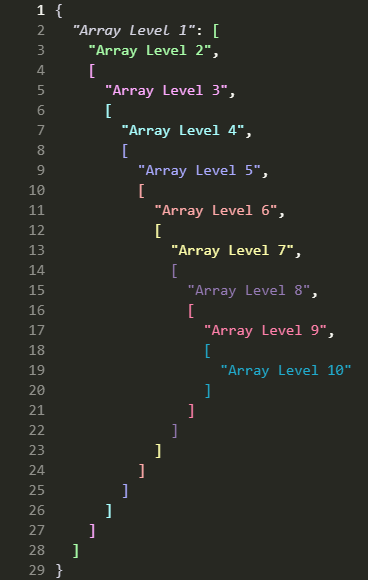 | 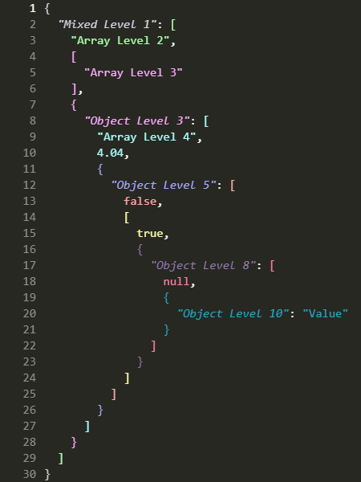 |

### Monokai Neon

The same Monokai base, with the depth ramp turned all the way up.

Neon uses Monokai's accent colors at full strength. Levels 1 to 7 are the foreground and the
colors Monokai gives to keywords, parameters, strings, functions, types, and constants.
Monokai only has seven, so levels 8 to 10 are extensions chosen to stay as distinct as
possible from everything above them.

Every pair of levels is at least dE 20 apart in CIELAB, so even ten levels down the colors
are designed to remain easy to tell apart.

This one is for when you don't want your nesting to whisper. You want it to make itself
known.

| Objects | Arrays | Mixed |
|---|---|---|
| 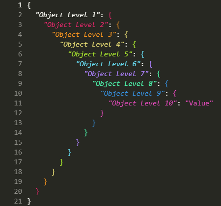 | 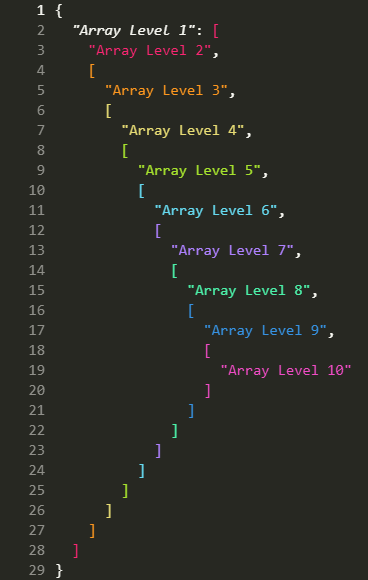 | 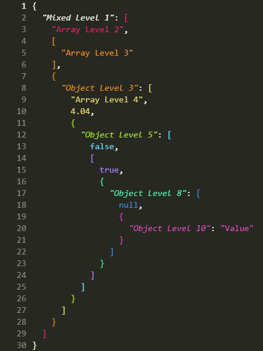 |

### Monokai Neue

A JSON version of **Monokai Neue** by Josh Kaplan, with its darker background and its own set
of accents. The depth ramp uses six of Neue's accent colors on a six-level cycle, kept
exactly as he wrote it. The base is the same, all 149 syntax rules, so everything outside
JSON still looks like the Neue you may already have installed.

The original Neue highlighting colored object keys, and only object keys. This version
extends that to string values, array elements, numbers, and booleans, colors arrays as
well as objects, and carries the cycle past level 10.

| Objects | Arrays | Mixed |
|---|---|---|
| 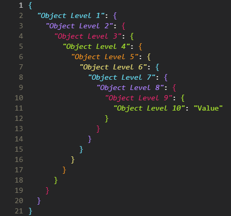 | 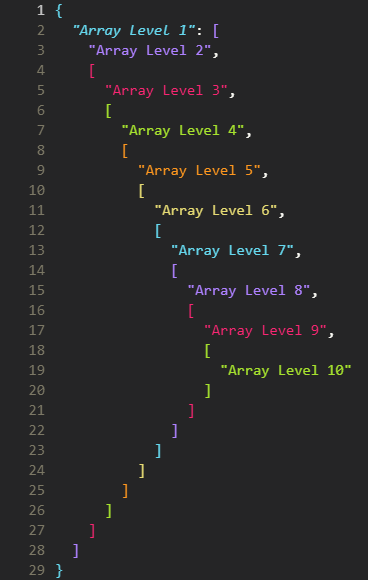 | 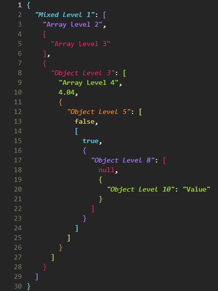 |

### Jazz Solo Cup

If you were alive in the 1990s and ever drank something from a disposable cup, there is a
decent chance you've seen this design.

**Jazz** was Sweetheart Cup Company's wonderfully loud teal-and-purple pattern: a jagged teal
brush stroke with a purple zig-zag floating above it. It was on cups, plates, bowls, and
basically anywhere a perfectly respectable beverage or serving of nachos could be accompanied
by an unnecessary amount of neon.

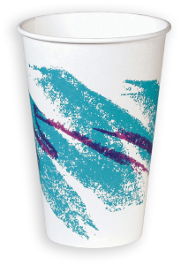

And then, somehow, the pattern escaped.

It became one of those oddly specific pieces of 1990s visual culture that people started
recognizing everywhere decades later. There are sightings blogs. Tattoos. Custom sneakers.
A minor-league baseball jersey. The internet, having apparently decided that disposable
tableware deserved a nostalgia revival, did the rest.

So naturally, I made it a JSON color theme. The palette borrows the same teal-and-purple
pairing.

If Monokai Classic is for people who want their JSON to look like a terminal, Jazz Solo Cup
is for people who want their JSON to look like it just came back from a 1994 birthday party.

| Objects | Arrays | Mixed |
|---|---|---|
| 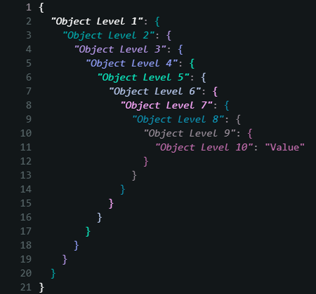 | 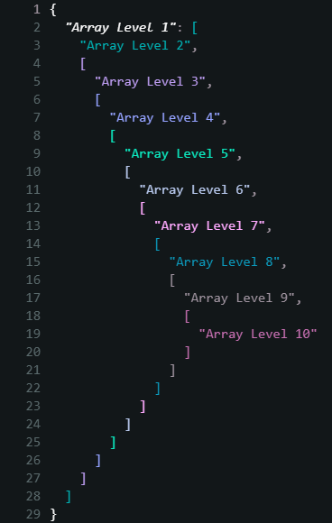 | 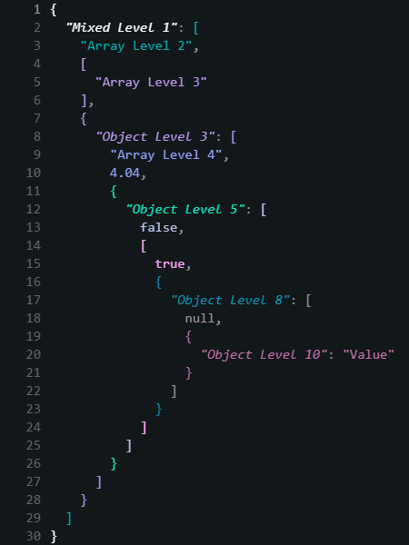 |

### VS Code Dark

The one for people who like the editor the way it comes.

**Dark 2026** is the theme Visual Studio Code ships with, and this is that theme with depth
colors layered on top. All 324 workbench colors and all 118 syntax rules are kept as they
are, so the only thing that changes is how deep JSON looks: open anything else and you are
looking at stock VS Code.

The depth ramp is Dark 2026's own syntax colors, in the order its rules use them, which is
why the file still reads as the same theme. Levels 1 to 6 are the foreground and the colors
it gives to constants, entity names, tags, keywords, and functions. Dark 2026 has only six
that are mutually distinct, so levels 7 to 10 reach back into the classic VS Code palette
that it inherits through `dark_modern`: the teal, the tan, the sage, and its debug purple.
Every pair of levels is at least dE 22 apart in CIELAB.

| Objects | Arrays | Mixed |
|---|---|---|
| 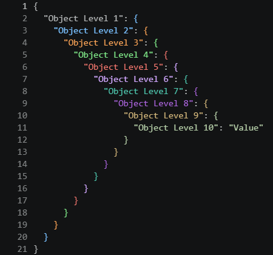 | 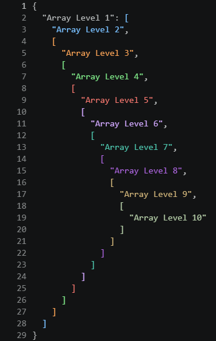 | 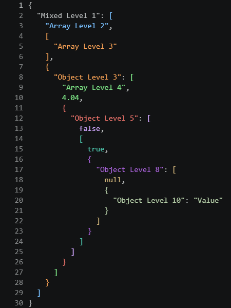 |

## Use a palette for JSON only

VS Code only allows one theme at a time and has no per-language setting, so you cannot
select a Deep JSON theme for JSON alone the way you can in Sublime Text. However, the depth
coloring comes from this extension's semantic token provider rather than from the theme,
the provider runs under whatever theme is active, and it labels JSON and nothing else. All
a theme does is map level to color, and that mapping can live in your own settings instead.

Run **Deep JSON: Add Depth Colors to Current Theme** from the Command Palette and pick one
of the twelve, vivid or muted. It writes that palette's level colors into
`editor.semanticTokenColorCustomizations`, scoped to your active theme, and offers to
colorize brackets past level 6. Picking a muted one brings its delimiter colors along, so
that is how you get muted brackets under your own theme. Nothing outside JSON changes,
including the background. Run it again to switch palettes or to pick up a palette that moved
in an update.

If one of these themes is already active, the command says so rather than opening the list,
since that theme's palette is already in use. There is a way past it if you want to look
anyway.

**Deep JSON: Remove Depth Colors from Current Theme** takes them back, and the notification
right after adding them carries an **Undo** as well. Either way only what was added comes
out: a rule you wrote yourself for the same level stays, rules under other themes stay, and
the `enabled` flag goes only if the command was the one that set it.

Depth colors stay attached to the theme they were added to, so if you switch themes and then
remove, it takes them off the theme you added them to rather than the one you are looking at,
and says which. Leaving them unreachable would be worse.

The add command accepts a palette name, so either command can be bound to a key or called
from another extension:

```json
[
  {
    "key": "ctrl+k j",
    "command": "jsonColorSchemes.addDepthColors",
    "args": "Deep JSON: Monokai Chalk"
  },
  {
    "key": "ctrl+k shift+j",
    "command": "jsonColorSchemes.removeDepthColors"
  }
]
```

Nothing stops you from deleting the `"[Your Theme]"` block out of
`editor.semanticTokenColorCustomizations` by hand either. The command will notice it is gone
and not complain.

To write the settings yourself instead, each theme under `themes/` keeps its palette in a
`semanticTokenColors` block; copy that into `editor.semanticTokenColorCustomizations` under
`"[Your Theme Name]"` alongside `"enabled": true`. The theme name has to match its label
exactly, which is the part worth letting the command do for you. Brackets then need
`jsonColorSchemes.deepBrackets` set to `on`, because `auto` only suppresses VS Code's own
colorizer while one of these themes is active; see *Bracket coloring* below.

*Developer: Inspect Editor Tokens and Scopes* shows which semantic token and which of your
rules apply at the cursor, if something looks wrong.

## Bracket coloring

Brackets and braces follow depth as well, each taking the color of the container it opens
or closes. Every palette ships in two bracket styles:

- **Vivid**, the plain theme name — brackets take exactly the content color at that depth
- **Muted**, the `(Muted Brackets)` one — the same hues desaturated, so brackets read as
  structure instead of competing with the content they wrap

| Vivid | Muted |
|---|---|
|  | 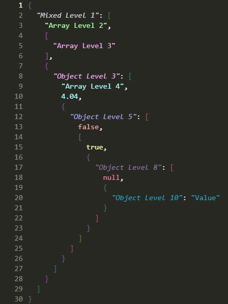 |

VS Code's own bracket colorizer has six color slots and repeats after level 6, so matching
brackets to depth any deeper means getting it out of the way for JSON. Run *Deep JSON:
Bracket Depth* from the Command Palette to choose when that happens:

| `jsonColorSchemes.deepBrackets` | Behavior |
| --- | --- |
| `auto` (default) | Depth coloring while one of these themes is active, built-in colorizer under any other |
| `on` | Depth coloring whatever the active theme |
| `off` | Always leave brackets to the built-in colorizer |

Suppressing the colorizer needs `editor.language.colorizedBracketPairs` set for `json` and
`jsonc`. There is no way for an extension to do this per theme, so the extension writes that
setting to your user settings and removes it again when you switch to another theme. A value
you set yourself is never changed or removed. Choose `off` if you would rather it left your
settings alone entirely, at the cost of brackets repeating after level 6.

The six slots are still colored from the palette either way, so brackets match depth to
level 6 even with `off`.

## Indentation guides

Each theme sets its own indent guide colors, derived from its palette so they belong to the
theme without competing with the content. VS Code distinguishes two:
`editorIndentGuide.background1` for every guide, and `editorIndentGuide.activeBackground1`
for the one at your cursor's indentation.

Four themes declare theirs rather than deriving them, because the colors belong to the
designs: Monokai Classic takes Hazenberg's `#9D550FB0`, Monokai Neue the blue of its own
first level, Jazz Solo Cup its `#00B1B3`, and VS Code Dark the two Dark 2026 already sets.
Monokai Chalk and Monokai Neon derive theirs from their palettes.

Unlike the depth colors, these cannot vary by nesting level: VS Code draws guides as editor
chrome rather than as tokens, so there is nothing for a per-level rule to attach to.

## Markdown highlighting

These are complete color themes rather than JSON-only ones, so they color every language
you open; JSON is just the part that gets depth coloring. The color schemes also add a full
rule set for markdown in all six palettes: headings, emphasis, inline and fenced code, quotes,
links, lists, tables, and the punctuation around them.

Monokai Neue and VS Code Dark inherit theirs from the themes they are built on. Monokai
Classic, Chalk, Neon and Jazz Solo Cup use the mapping below, drawn from each palette's own
accents.

| Element | Monokai Classic, Chalk, Neon | Jazz Solo Cup |
|---|---|---|
| Prose | the default foreground | teal |
| Headings | orange, bold | violet, bold |
| Bold and italic | pink | pink |
| Inline code | yellow | mint |
| Block quotes | cyan, italic | lavender, italic |
| Link URLs | cyan, underlined | lavender, underlined |
| Link text and titles | green | violet |
| List bullets | pink | violet |
| References and escapes | purple | white |
| Hashes, ticks, pipes, quote arrows | comment grey | foreground grey |

Every structural mark takes the palette's comment color, so the prose stays the thing you
read and the punctuation holding it up recedes. A fenced block that names a language keeps
that language's own highlighting: only the ticks and the language label are colored.

Jazz is the one that colors prose rather than leaving it the default foreground. It is a
wide teal stroke with a thin purple zig-zag above it, so the teal is the base and carries
the prose, and the purple family carries the structure on top of it.

The four hand-written palettes had almost none of this before. The `.tmTheme` files they
came from carried three markup rules between them, all of them for diffs, so a Markdown
file rendered as one flat color.

## Customize the colors

You don't have to edit the extension. Override any level from your own settings:

```json
"editor.semanticTokenColorCustomizations": {
  "[Deep JSON: Monokai Chalk]": {
    "rules": {
      "*.level2": "#7FDBCA",
      "*.level3": "#C792EA"
    }
  }
}
```

Those survive updates to the extension.

## Why I built this

I've spent way too much time drafting and editing OpenAPI specs. The kind where you open a
response schema, follow `properties` into another object, find an `allOf`, fall into a few
more levels of nesting, and eventually realize you're spending as much effort keeping
track of the structure as you are reading the content. By the time you reach something as
ordinary as a field's `type`, you are typically eleven levels deep.

In a single flat color, reading a spec like that means counting braces and matching
indentation to work out which object you are actually looking at. I got tired of counting
braces. Giving each level of nesting its own color turns that into something you can just
see: content that shares a color shares a level.

When the structure gets that deep, indentation only gets you so far. I wanted something
that made the hierarchy visible without having to mentally trace it.

So I wrote **Monokai JSON++** for Sublime Text 2, an extended version of Monokai JSON+ by
ColibriApps, then added **Jazz Solo Cup** for Sublime Text 3. Both stopped working on
Sublime Text 4. This project is the port to Visual Studio Code since I use both editors.
The palettes are the originals, recovered from the old `.tmTheme` files by recomputing
each rule's depth from its selector.

That depth is also why this version runs to 20 levels and cycles rather than stopping at 10.
The old cap was a consequence of how the schemes had to be built, not a decision, and
it ran out of colors one level short of where an OpenAPI spec puts a field's type.

## How depth coloring works

VS Code's JSON grammar does expose nesting through TextMate scopes, but not in a form a
theme can count: an object level contributes two scopes and an array level one, so matching
depth would mean enumerating every ordering of ancestors. Ten levels needs about 3,000
selectors.

So depth comes from parsing instead. The extension registers a
`DocumentSemanticTokensProvider` for JSON and JSONC, walks the document, and tags every
value with its nesting depth as a semantic token modifier. A theme then colors by depth:

```json
"semanticTokenColors": {
  "*.level1": "#D6D5E3",
  "*.level2": "#AAFFAA"
}
```

Levels 1 to 10 use the palette and then it cycles, up to level 20. Anything deeper keeps
the level 20 color. Because the depth comes from a parser rather than from pattern matching,
there is no ceiling on how deep a document may be.

Object keys are tagged `property`, strings `string`, numbers `number`,
`true`/`false`/`null` `keyword`, and braces and brackets `jsonPunctuation`. So a theme can
color by depth alone with `*.levelN`, or treat one kind differently at the same depth with
`property.levelN` or `jsonPunctuation.levelN`.

## Development and extending the themes

The themes are generated, so the palettes stay identical to the Sublime versions.
`check_palettes.py` compares four things against that repo: the level colors, the muted
delimiter colors, the indent guides, and the Markdown rules.

```bash
python dev/build_themes.py      # regenerate themes/ from dev/palettes.py
python dev/check_palettes.py    # compare against the Sublime repo, if checked out
npm test                        # scanner, encoder, policy, palette and theme tests
npm run package                 # build the .vsix, which the capture harness installs
npm run capture-screenshots     # regenerate screenshots/ from the editor itself
npm run verify-screenshots      # check those images against the palettes
```

Screenshots are generated, not taken by hand. `dev/capture_screenshots.js` drives a
throwaway VS Code profile over the Chrome DevTools Protocol, so your own settings and
selected theme are untouched, and it waits until every token in the document carries
the color the scanner says it should before pressing the shutter. That wait is the whole
point. Three things land at three different times: the lines render, the semantic tokens
arrive, and the bracket policy takes effect. Capture between any two of them and the image
looks plausible but is wrong.

`dev/verify_screenshots.py` then checks the written pixels against each theme's palette,
for brackets as well as content. It needs Pillow, as does `dev/make_icon.py`, which draws
`images/icon.png` from the palette definitions so the icon cannot drift from the shipped
colors. Nothing else in `dev/` has a dependency.

There are four samples. `object.json`, `array.json` and `mixed.json` are synthetic: one
token per line at a known depth, which is what makes a pixel check possible, since the
verifier bands rows and takes the dominant color. `openapi.json` is realistic instead, so
its rows carry several levels each and it is captured but not pixel-checked. Its colors are
verified per token at capture time.

`npm test` runs five suites. `test/test_scanner.js` checks the parser against the same
line-to-level expectations used to verify the Sublime schemes, so both editors color
identical JSON identically, and covers comments, trailing commas, truncated documents,
unterminated strings, escaped quotes and 30-level nesting. `test/test_encode.js` round-trips
the delta encoding and measures what an edit costs to report. `test/test_deep_brackets.js`
enumerates the whole bracket policy table, including the cases where a setting must be left
untouched. `test/test_palette_customization.js` does the same for putting a palette on
somebody else's theme, where the costly mistakes are overwriting a rule the user wrote and
failing to clean up after one of ours. `test/test_themes.js` resolves every sample
token through each theme's rules, checks the palette cycling, and verifies that the
generated theme label list still matches the manifest.

## Credits

Inspired by [Monokai JSON+](https://github.com/ColibriApps/MonokaiJsonPlus/) by ColibriApps for Sublime Text 2.

Monokai Classic is derived from the Monokai palette by Wimer Hazenberg.

Monokai Neue is derived from [Monokai Neue](https://github.com/josh-kaplan/sublime-monokai-neue) by Josh Kaplan.

Jazz Solo Cup borrows the colors of the *Jazz* cup design, created at Sweetheart Cup
Company and introduced in 1992.

VS Code Dark is derived from Dark 2026, from the MIT-licensed
[microsoft/vscode](https://github.com/microsoft/vscode) repository, Copyright (c) Microsoft
Corporation.

## License

Copyright (C) 2026 [Lance Duvall](https://github.com/lanz).

Licensed under the [GNU Affero General Public License v3.0](LICENSE) or later.
